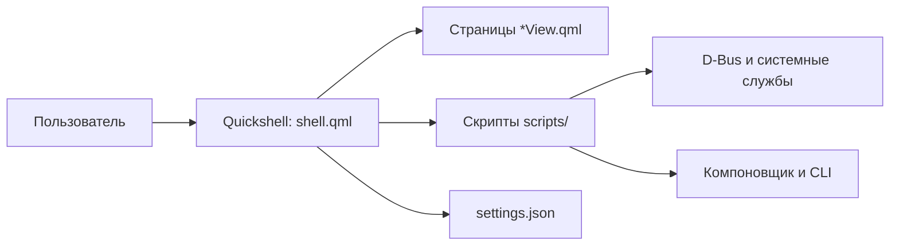
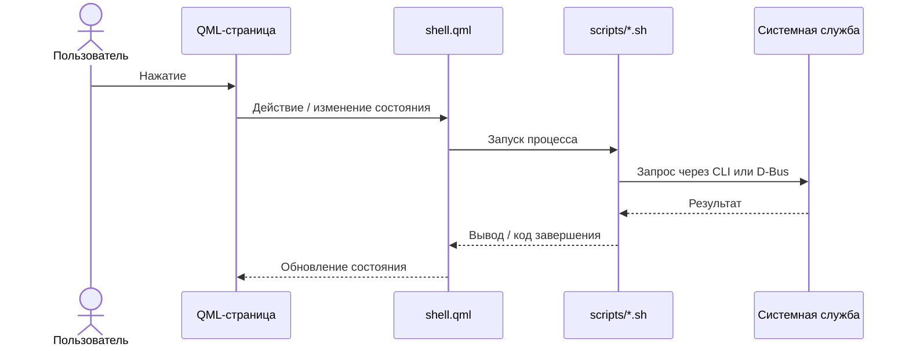

# Архитектура

`shell.qml` координирует состояние острова, страницы, уведомления, процессы и IPC. Отдельные QML-представления реализуют экранные разделы; компоненты `Set*.qml` составляют настройки. `Compositor.qml` абстрагирует различия Hyprland и Niri. Скрипты в `panacea/scripts` взаимодействуют с системными утилитами и службами. Переводы интерфейса находятся в `Translations.qml`, палитры — в `Themes.js`.

## Каталоги

- `panacea/` — оболочка, скрипты, звуки и настройки.
- `hypr/`, `niri/` — конфигурации компоновщиков и точки расширения.
- `fish/`, `foot/`, `fastfetch/`, `nano/` — настройки программ.
- `sddm/`, `grub/` — темы входа и загрузчика.
- `applications/`, `bin/` — desktop-файлы и вспомогательные команды.

Panacea сама обслуживает уведомления и запросы polkit; одновременный запуск другого демона уведомлений может привести к конфликту. Настройки хранятся в `~/.config/panacea/settings.json`; пользовательские файлы и особенности обновления описаны в [[Установка и обновления]].

## Состояние и жизненный цикл

Корневой `shell.qml` хранит состояние раскрытия, выбранной страницы, системных данных и конфигурации. Для страницы создаётся соответствующий компонент; общие параметры передаются ему через `sys`. Долгие или привилегированные операции вынесены в скрипты и службы: это позволяет QML отвечать за представление, а системным утилитам — за работу с ОС.

## Слои Wayland

Остров и отдельные полноэкранные поверхности реализованы как окна layer-shell. Виджеты находятся на нижнем слое, над обоями и под обычными окнами. Интерактивная область ограничена карточками. Для ввода в ScratchPad слой объявляет клавиатуру `OnDemand`: компоновщик передаёт её при нажатии. При редактировании дополнительная прозрачная поверхность позволяет щелчком по пустому рабочему столу завершить ввод.

## Состояние и файлы

| Данные | Расположение по умолчанию |
|---|---|
| Настройки оболочки | `~/.config/panacea/settings.json` |
| Быстрые заметки | `~/.local/share/panacea/scratchpad.txt` |
| Раскладка Launchpad | `~/.local/share/panacea/launchpad.json` |
| Скриншоты | `~/Pictures/Screenshots/` |
| Закреплённые элементы буфера | `~/.config/panacea/clipboard_pins.json` |
| Версия установленного исходника | `~/.config/panacea/.version` |

Пути поддерживают XDG-переменные там, где они предусмотрены соответствующим компонентом. Не храните парольные записи в открытом ScratchPad: у менеджера паролей отдельное шифруемое хранилище.

## Индекс Graphify

`graphify-out/graph.json` содержит локальный машинный граф, а `graph.html` — интерактивное представление. В установленной версии анализатор пропускает QML, поэтому граф не описывает всю оболочку. При работе с интерфейсом проверяйте соответствующие исходные QML-файлы и страницы этого vault. После изменения поддерживаемого кода граф обновляется командой `graphify update .`.
