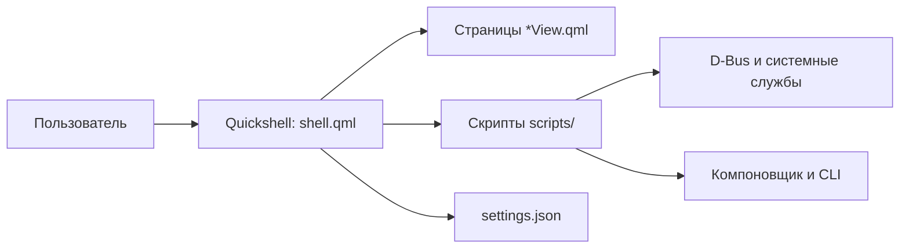

# Архитектура

`shell.qml` координирует состояние острова, страницы, уведомления, процессы и IPC. Отдельные QML-представления реализуют экранные разделы; компоненты `Set*.qml` составляют настройки. `Compositor.qml` абстрагирует различия Hyprland и Niri. Скрипты в `panacea/scripts` взаимодействуют с системными утилитами и службами. Переводы интерфейса находятся в `Translations.qml`, палитры — в `Themes.js`.

## Каталоги

- `panacea/` — оболочка, скрипты, звуки и настройки.
- `hypr/`, `niri/` — конфигурации компоновщиков и точки расширения.
- `fish/`, `foot/`, `fastfetch/`, `nano/` — настройки программ.
- `sddm/`, `grub/` — темы входа и загрузчика.
- `applications/`, `bin/` — desktop-файлы и вспомогательные команды.

Panacea сама обслуживает уведомления и запросы polkit; одновременный запуск другого демона уведомлений может привести к конфликту. Настройки хранятся в `~/.config/panacea/settings.json`; пользовательские файлы и особенности обновления описаны в [[Установка и обновления]].
