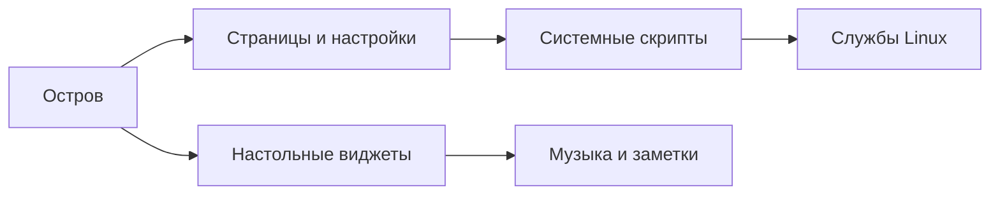

# Panacea · база знаний

> [!abstract] Что это
> Panacea — оболочка рабочего стола на **Quickshell / QML**. Она объединяет остров, быстрые настройки, файлы, медиа, уведомления и настройки системы. Основной компоновщик — Hyprland; поддержка Niri экспериментальная.

## Начать здесь

| Раздел | Содержание |
|---|---|
| [[Возможности]] | Все основные страницы и сочетания клавиш |
| [[Рабочий стол и виджеты]] | Остров, карточки, музыка и быстрые заметки |
| [[Файлы, медиа и буфер]] | Проводник, просмотрщик, запись и скриншоты |
| [[Сеть, звук и питание]] | Быстрые настройки и взаимодействие с системой |
| [[Настройки и персонализация]] | Интерфейс настроек, темы и сочетания |
| [[Установка и обновления]] | Установка, обновление и сохранение изменений |
| [[Архитектура]] | Как связаны QML, службы и системные скрипты |
| [[Диагностика]] | Проверки, если что-то работает не так |
| [[Карта исходников]] | Перечень QML-компонентов и скриптов |

> [!info] О документации
> Описание основано на исходниках и README репозитория. Доступность функций зависит от оборудования, установленных программ, компоновщика и выбранных настроек. Изменения в локальной установленной копии могут отличаться от репозитория.

## Быстрая карта

